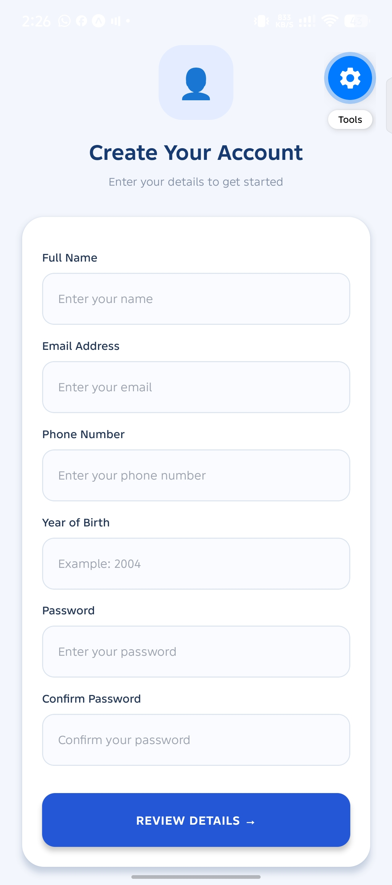
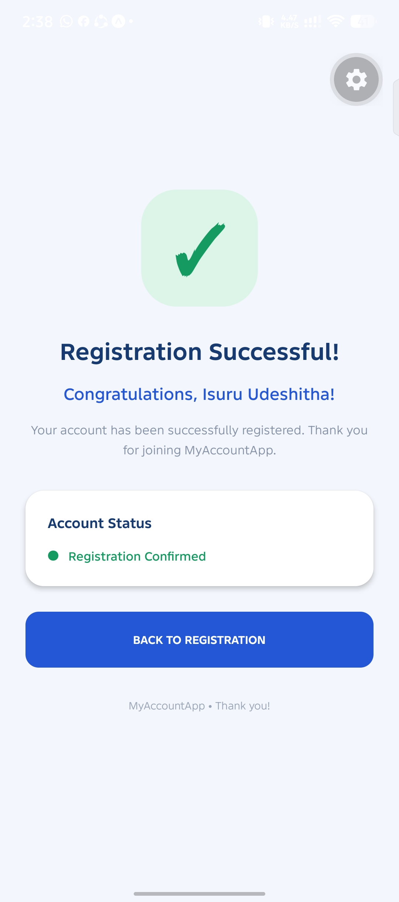
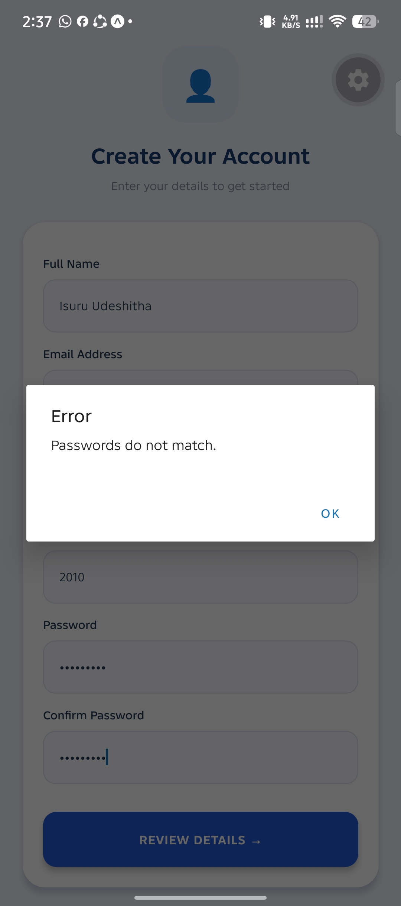
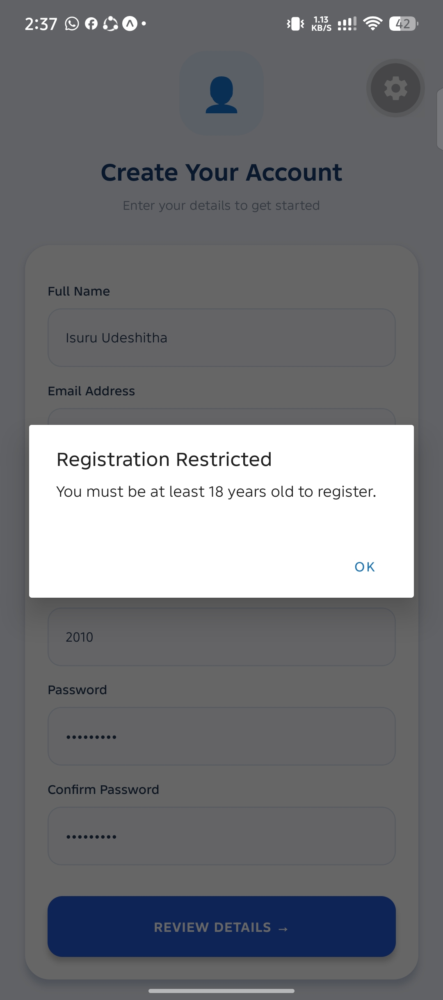
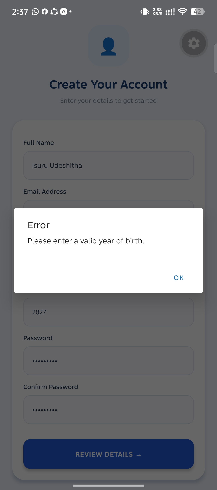

# 📱 MyAccountApp – Registration and User Information Management

A React Native mobile application developed using **Expo and Expo Router** as part of the Mobile Application Development – Practical Tutorial 04 at the University of Kelaniya.

MyAccountApp demonstrates user registration, form validation, data transfer between screens, age calculation, and navigation using React Native and Expo Router.

---

## 📌 Project Information

| Item             | Details                        |
| ---------------- | ------------------------------ |
| Project Name     | MyAccountApp                   |
| Practical        | Practical Tutorial 04          |
| Module           | Mobile Application Development |
| Student Name     | Isuru Udeshitha                |
| Student ID       | PS/2022/036                    |
| Degree Programme | BSc Physical Science           |
| Faculty          | Faculty of Science             |
| University       | University of Kelaniya         |

---

## 🚀 Project Overview

MyAccountApp is a mobile application that allows users to enter personal information through a registration form, review their submitted information, and confirm their registration.

The application demonstrates important mobile application development concepts, including React hooks, input validation, screen navigation, parameter passing, and conditional logic.

The application consists of three main screens:

1. **Registration Screen** – Collects user information and validates form inputs.
2. **Review Screen** – Displays the submitted information and calculated age.
3. **Success Screen** – Displays a personalized registration confirmation message.

---

## ✨ Features

### 1. Registration Screen

- Full name input.
- Email address input.
- Phone number input.
- Year of birth input.
- Password input.
- Confirm password input.
- Empty-field validation.
- Email format validation.
- Phone number validation.
- Password matching validation.
- Birth year validation.

### 2. Review Details Screen

- Displays the submitted full name.
- Displays the email address.
- Displays the phone number.
- Displays the calculated age.
- Allows users to return to the registration screen.
- Provides registration confirmation navigation.

### 3. Success Screen

- Personalized success message.
- Displays the registered user's name.
- Registration confirmation status.
- Navigation back to the registration screen.

### 4. Age Calculation and Restriction

- Calculates age using the current year and year of birth.
- Restricts registration for users under 18.
- Rejects invalid birth years.
- Displays appropriate validation alerts.

---

## 🛠️ Technologies Used

| Technology              | Purpose                        |
| ----------------------- | ------------------------------ |
| React Native            | Mobile application development |
| Expo                    | Development environment        |
| Expo Router             | File-based navigation          |
| TypeScript              | Application development        |
| JavaScript              | Application logic              |
| React Hooks             | State and lifecycle management |
| React Native StyleSheet | UI styling                     |
| Expo Go                 | Mobile application testing     |

---

## 📚 React Native Concepts Demonstrated

### 1. useState()

Used to store and manage registration form values.

```tsx
const [userName, setUserName] = useState("");
const [email, setEmail] = useState("");
const [phoneNumber, setPhoneNumber] = useState("");
const [password, setPassword] = useState("");
const [confirmPassword, setConfirmPassword] = useState("");
const [yearOfBirth, setYearOfBirth] = useState("");
```

### 2. TextInput

Used to collect user information through input fields.

### 3. Form Validation

The application checks:

- Empty input fields.
- Invalid email addresses.
- Invalid phone numbers.
- Password mismatches.
- Invalid birth years.
- Age restrictions.

### 4. Age Calculation

The application calculates the user's age using:

```tsx
const currentYear = new Date().getFullYear();

const age = currentYear - birthYear;
```

Users below 18 years of age are prevented from proceeding with registration.

**Note:** This implementation calculates age using the birth year only and does not verify the exact birth date.

### 5. Screen Navigation

Expo Router is used to navigate between the registration, review, and success screens.

```tsx
router.push("/review");
```

### 6. Data Transfer Between Screens

Registration information is transferred using route parameters.

```tsx
router.push({
  pathname: "/review",
  params: {
    userName: userName.trim(),
    email: email.trim(),
    phoneNumber: phoneNumber.trim(),
    age: String(age),
  },
});
```

### 7. Receiving Parameters

The Review screen retrieves the transferred information using:

```tsx
const { userName, email, phoneNumber, age } = useLocalSearchParams();
```

### 8. Back Navigation

Users can return to the previous screen using:

```tsx
router.back();
```

---

## 🧭 Application Navigation Structure

The application uses Stack Navigation through Expo Router.

```text
MyAccountApp
│
└── Stack Navigation
    │
    ├── Registration Screen
    │       index.tsx
    │
    ├── Review Screen
    │       review.tsx
    │
    └── Success Screen
            success.tsx
```

### Application Workflow

```text
User Opens Application
         |
         v
Registration Screen
         |
         v
Validate User Inputs
         |
         v
Calculate Age
         |
         v
Is User 18 or Older?
       /   \
     No     Yes
     |       |
     v       v
 Show Alert  Review Screen
                 |
                 v
         Review Information
                 |
                 v
       Confirm Registration
                 |
                 v
          Success Screen
```

---

## 📂 Project Structure

```text
MyAccountApp/
│
├── Output_Screens/
│   ├── 01_registration.jpg
│   ├── 02_review.jpg
│   ├── 03_success.jpg
│   ├── 04_password_validation.jpg
│   ├── 05_age_restriction.jpg
│   └── 06_invalid_birth_year.jpg
│
├── assets/
│
├── src/
│   ├── app/
│   │   ├── _layout.tsx
│   │   ├── index.tsx
│   │   ├── review.tsx
│   │   ├── success.tsx
│   │   └── explore.tsx
│   │
│   ├── components/
│   ├── constants/
│   ├── hooks/
│   └── global.css
│
├── app.json
├── package.json
├── package-lock.json
├── tsconfig.json
├── README.md
└── .gitignore
```

---

## ⚙️ Installation and Setup

### Prerequisites

- Node.js
- npm
- Visual Studio Code
- Expo Go mobile application

### 1. Clone the Repository

```bash
git clone https://github.com/isuru6106/MyAccountApp.git
```

### 2. Navigate to the Project Directory

```bash
cd MyAccountApp
```

### 3. Install Dependencies

```bash
npm install
```

### 4. Start the Expo Development Server

```bash
npx expo start
```

### 5. Run the Application

1. Open Expo Go on your mobile device.
2. Scan the QR code displayed by Expo.
3. Wait for the application to load.
4. Test the registration workflow.

---

## 📸 Application Screenshots

Screenshots demonstrating the application's functionality are available in the `Output_Screens` directory.

### 1. Registration Screen

The registration screen allows users to enter their personal information.



### 2. Review Details Screen

Displays the information submitted by the user, including the calculated age.


### 3. Registration Success Screen

Displays a personalized confirmation message after registration.



### 4. Password Validation

Demonstrates the password mismatch validation alert.



### 5. Age Restriction

Demonstrates the restriction applied to users below 18 years of age.



### 6. Invalid Birth Year

Demonstrates validation for an invalid or future birth year.



---

## 🎯 Learning Outcomes

Through this practical application, the following concepts were implemented:

1. Creating mobile registration forms.
2. Managing form inputs using React Native.
3. Managing application state using `useState()`.
4. Validating user input.
5. Handling password confirmation.
6. Calculating age from birth year.
7. Implementing age-based restrictions.
8. Navigating between screens using Expo Router.
9. Passing information between screens.
10. Retrieving route parameters using `useLocalSearchParams()`.
11. Implementing back navigation.
12. Displaying alerts and confirmation messages.

---

## 🔗 GitHub Repository

**Repository:**  
https://github.com/isuru6106/MyAccountApp

---

## 👨‍🎓 Developer

**Isuru Udeshitha**

BSc Physical Science  
Faculty of Science  
University of Kelaniya

Student ID: PS/2022/036

---

## 📄 Academic Information

**Module:** Mobile Application Development  
**Practical:** Tutorial 04  
**University:** University of Kelaniya

This project was developed for educational and academic purposes as part of the Mobile Application Development practical coursework.

---

## 📜 License

This project is intended for educational and academic purposes.
